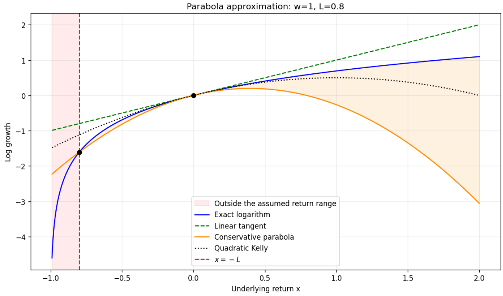

# Bet sizing with large events

Consider univariate returns $x$; optimal growth rate choses the leverage/weight $w$ that maximizes

$$
G(w)=\mathbb E[\log(1+wx)]
$$

A common approximation is to consider small returns and expand up to second order:

$$
\log(1+wx)\approx wx-\frac{w^2x^2}{2}
$$

Taking expectations and optimizing gives the quadratic Kelly allocation

$$
w_Q=\frac{\mu}{m_2}
$$

where $\mu=\mathbb E[x]$ and $m_2=\mathbb E[x^2]$ is the second noncentral moment. This is an approximation to the optimum, not generally the exact Kelly allocation. 
Its limitation is that large values of $wx$, especially losses near $-1$, are poorly represented by a quadratic expansion around zero. In practice, we can use a fraction of this optimal bet to account for this and other uncertainties , but it leaves us to choose the fraction.

One thing we can notice from the previous construction is that it is a second order polynomial approximation to the logarithm and we just happen to make it match near $x=0$. We can use the same idea of using a parabola to approximate $\log(1+wx)$ but we force it to different constraints.
Instead of matching the logarithm's up to second order at zero, we can fit a more _curved_ parabola that passes through a worst case loss - this can be done an aditional constraint that can be taken as having the same slope near zero.

## Specify the loss bound

Assume

$$
x\ge-L,\qquad L>0
$$

To ensure positive wealth under this bound, exposure has to be restricted to

$$
0\le w<\frac1L
$$

Then $1+wx\ge1-wL>0$, so the logarithm is defined for every possible return.

Write

$$
\mu=\mathbb E[x],\qquad m_2=\mathbb E[x^2]=\sigma^2+\mu^2
$$

and assume $0<m_2<\infty$ and $\mu>0$ without loss of generality. 

The bound $L$ concerns the underlying investment's loss; the associated portfolio loss is at most $wL$. This value $L$ can be estimated from data as the largest loss or a multiple of it to be more conservative.

## Define the approximation

For a fixed exposure $w$, define

$$
f_w(x)=\log(1+wx)
$$

We want a quadratic approximation

$$
q_w(x)=a+bx-cx^2
$$

Matching the value and slope at zero gives

$$
q_w(0)=f_w(0)=0\quad\Longrightarrow\quad a=0
$$

$$
q_w'(0)=f_w'(0)=w\quad\Longrightarrow\quad b=w
$$

Thus

$$
q_w(x)=wx-cx^2
$$

Now make the approximation exact at the worst permitted return, $x=-L$:

$$
q_w(-L)=-wL-cL^2=\log(1-wL)
$$

Solving for $c$ gives

$$
c=\frac{-\log(1-wL)-wL}{L^2}
$$

Therefore

$$
q_w(x)=wx+\frac{x^2}{L^2}\left[\log(1-wL)+wL\right]
$$

The parabola is tangent to the logarithm at zero and passes through it at $x=-L$. Ordinary quadratic Kelly matches the curvature at zero; this construction calibrates the curvature to the worst-loss point making it more concave (which gives a higher penalty on fluctuations).

The next figure illustrates the idea and compares with the alternatives.

## Optimize the approximation

Taking expectations gives

$$
\widetilde G(w):=\mathbb E[q_w(x)] =\mu w+\frac{m_2}{L^2}\left[\log(1-wL)+wL\right] 
$$

We now maximize this lower bound. Its derivative is

$$
\widetilde G'(w)=\mu-\frac{m_2w}{1-wL}
$$

Setting it to zero yields

$$
\mu(1-wL)=m_2w
$$

and therefore

$$
w_D=\frac{\mu}{m_2+\mu L}
$$

Using $w_Q=\mu/m_2$, we can write it as

$$
w_D=\frac{w_Q}{1+Lw_Q}
$$

The reduction depends on $Lw_Q$ which is the worst permitted portfolio loss under quadratic Kelly sizing. A larger value produces a stronger reduction. Using $\mu/\sigma^2$ in place of $w_Q$ additionally neglects $\mu^2$ and is not the exact formula derived here.

The result optimizes the lower bound, not necessarily the original $G$ but keeps growth positive. With $r=\mu L/m_2$,

$$
G(w_D)\ge\widetilde G(w_D)=\frac{m_2}{L^2}[r-\log(1+r)]>0
$$

This does not establish how close the allocation is to optimal nor is it a complete model of fat tails: it is just a way to change the curvature of the approximation to account for a large loss.

### The case of a possible total loss

Holding $\mu$ and $m_2$ fixed,

$$
\lim_{L\to1}w_D=\frac{\mu}{m_2+\mu}=\frac{w_Q}{1+w_Q}
$$

At $L=1$, the assumption $x\ge-1$ means the underlying asset cannot lose more than 100% in one period. The allocation remains below one, leaving

$$
1-w_D=\frac1{1+w_Q}
$$

of wealth in cash. For example, $\mu=0.01$ and $\sigma=0.05$ give $w_Q\approx3.846$ and $w_D\approx0.794$, provided those moments come from a return model satisfying $x\ge-1$.

This provides a concrete alternative to selecting a Kelly fraction arbitrarily: fit the approximation to a specified downside endpoint, then let that endpoint determine the reduction in exposure. 
