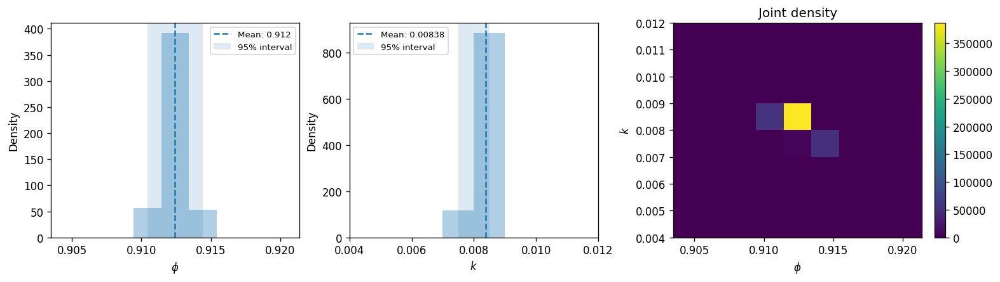
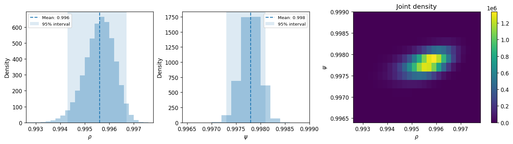

# Bayesian model for trend following

Consider a sequence of returns $x_1,x_2,\ldots$. We assume that returns are driven by an unobserved, time-varying mean $\mu_t$ and variance $v_t$. A generic formulation is

$$
(\mu_{t-1},v_{t-1})\longrightarrow(\mu_t,v_t)\longrightarrow x_t
$$

Given the observations up to time $t$, we are interested in the filtering distribution

$$
p(\mu_t,v_t\mid x_{1:t})\propto p(x_t\mid\mu_t,v_t)p(\mu_t,v_t\mid x_{1:t-1})
$$

where the predictive distribution is

$$
p(\mu_t,v_t\mid x_{1:t-1})=\iint p(\mu_t,v_t\mid\mu_{t-1},v_{t-1})p(\mu_{t-1},v_{t-1}\mid x_{1:t-1})\,\mathrm d\mu_{t-1}\,\mathrm dv_{t-1}
$$

The first equation describes how an observation changes our beliefs; the second describes how our beliefs evolve between observations. To make the problem tractable, we assume a Gaussian observation model,

$$
p(x_t\mid\mu_t,v_t)=N(x_t\mid\mu_t,v_t)
$$

and approximate the filtered distribution by a product of a normal and an inverse-gamma:

$$
p(\mu_{t-1},v_{t-1}\mid x_{1:t-1})\approx N(\mu_{t-1}\mid m_{t-1},q_{t-1})IG(v_{t-1}\mid a_{t-1},b_{t-1})
$$

We also assume a prediction transformation that preserves this family, giving

$$
p(\mu_t,v_t\mid x_{1:t-1})\approx N(\mu_t\mid m_t^-,q_t^-)IG(v_t\mid a_t^-,b_t^-)
$$

Here $q$ is a variance, and the inverse-gamma uses the shape-scale convention, with density proportional to $v^{-a-1}\exp(-b/v)$. We will specify the evolution of these parameters later. 

## Mean-field posterior

With this model, after observing $x_t$, the joint posterior does not have a convenient closed-form expression. We use a mean-field approximation,

$$
p(\mu_t,v_t\mid x_{1:t})\approx Q_\mu(\mu_t)Q_v(v_t)
$$

with

$$
\begin{aligned}
\log Q_\mu(\mu_t)&=\mathbb E_{Q_v}\left[\log p(\mu_t,v_t\mid x_{1:t})\right]+C_\mu\\
\log Q_v(v_t)&=\mathbb E_{Q_\mu}\left[\log p(\mu_t,v_t\mid x_{1:t})\right]+C_v
\end{aligned}
$$

For the mean, keeping only terms that depend on $\mu_t$ gives

$$
\log Q_\mu(\mu_t)=-\frac{(\mu_t-m_t^-)^2}{2q_t^-}-\frac12\mathbb E_{Q_v}\left\[v_t^{-1}\right\](x_t-\mu_t)^2+C
$$

This is quadratic in $\mu_t$, so $Q_\mu=N(m_t,q_t)$, with

$$
\begin{aligned}
\lambda_t&=\mathbb E_{Q_v}[v_t^{-1}],\\
q_t^{-1}&=(q_t^-)^{-1}+\lambda_t,\\
m_t&=q_t\left(\frac{m_t^-}{q_t^-}+\lambda_t x_t\right)
\end{aligned}
$$

Similarly, for the variance,

$$
\log Q_v(v_t)=-\left(a_t^-+1+\frac12\right)\log v_t-\frac{b_t^-+\frac12\mathbb E_{Q_\mu}[(x_t-\mu_t)^2]}{v_t}+C
$$

We recover $Q_v=IG(a_t,b_t)$, with

$$
\begin{aligned}
a_t&=a_t^-+\frac12,\\
b_t&=b_t^-+\frac12\left[(x_t-m_t)^2+q_t\right]
\end{aligned}
$$

Since $\lambda_t=a_t/b_t$, the two updates remain coupled. Nevertheless, we have recovered the same family of distributions as the prior, which allows the procedure to be repeated as new observations arrive.

### Decoupling

We can exploit the fact that the predictable component is typically small compared with the scale of unpredictable fluctuationso in financial returns. If both $|m_t|$ and $\sqrt{q_t}$ are small relative to typical return volatility, the correction to the squared return, $-2x_tm_t+m_t^2+q_t$, is usually small on the variance scale. We can therefore approximate

$$
\mathbb E_{Q_\mu}[(x_t-\mu_t)^2]\approx x_t^2
$$

The variance update becomes independent of the mean:

$$
a_t=a_t^-+\frac12,\qquad b_t\approx b_t^-+\frac12x_t^2
$$

We can now estimate the variance first and use it to estimate the mean. This is a one-way dependence, rather than a claim that the latent quantities are statistically independent.

## Predictive distribution

To evaluate the model, we need the distribution of a new return before observing it. Under the factorized prior, integrating out the normal mean gives

$$
p(x_t\mid x_{1:t-1})\approx\int_0^\infty N(x_t\mid m_t^-,v+q_t^-)IG(v\mid a_t^-,b_t^-)\,\mathrm dv
$$

If uncertainty about the mean is small compared with observation variance, we can also neglect $q_t^-$ in this expression. The remaining Gaussian–inverse-gamma mixture has a Student-$t$ distribution:

$$
x_t\mid x_{1:t-1}\approx t_{2a_t^-}\left(m_t^-,\sqrt{\frac{b_t^-}{a_t^-}}\right)
$$

The second argument is the scale, not the standard deviation. This is useful because a heavy-tailed predictive distribution emerges even though returns are assumed Gaussian conditional on the latent parameters. Notice that the predictive distribution uses the prior parameters, before updating them with $x_t$.


## Parameter evolution

### General principles

We now need to specify how a latent quantity evolves before a new observation arrives. For a generic latent parameter $\theta$, let $M$ denote its filtered expectation and $U=\mathcal U(Q)$ some appropriate measure of uncertainty about it. We want the prediction transformation to do two things. First, in the absence of a reason for systematic movement, we preserve the current expectation. More generally, if there is a long-term equilibrium $\bar\theta$, we allow partial reversion towards it. Second, although we have specified where we expect the parameter to go, we do not know its actual realization and therefore choose to increase uncertainty:

$$
M^-=AM+(1-A)\bar\theta,\qquad U^->U
$$

Here $A\in[0,1]$ is the persistence of the expected parameter. 

For a real-valued location parameter, such as a conditional expected return, variance is a natural measure of uncertainty. It is invariant under translation. For a positive scale parameter, such as return variance, uncertainty relative to its expected level is more natural.

### Variance

The expectation of an inverse-gamma distribution is $h=b/(a-1)$, and its squared coefficient of variation is $1/(a-2)$ when $a>2$. Thus $a$ is a convenient quantity to be discounted; discounting it at rate $\phi$ increases relative uncertainty, irrespective of how the expected level changes. 

We can consider then the following transformation to possess the correct properties:

$$
\begin{aligned}
a_t^-&=1+\phi(a_{t-1}-1)\\
g_t&=(1-k)h_{t-1}+k\bar v\\
b_t^-&=(a_t^--1)g_t
\end{aligned}
$$

Here $g_t$ is the predictive expected variance. The transformation makes $\mathbb E[v_t\mid x_{1:t-1}]=g_t$ (our assumption) and the relative uncertainty increases. 

Using the decoupled observation update, the shape follows a deterministic recursion with fixed point $a_\infty=1+1/[2(1-\phi)]$. Initializing at this point, the entire variance recursion simplifies to

$$
\begin{aligned}
g_t&=(1-k)h_{t-1}+k\bar v\\
h_t=\mathbb E[v_t\mid x_{1:t}]&=\phi g_t+(1-\phi)x_t^2
\end{aligned}
$$

When $k=0$, this is the usual exponentially weighted average of squared returns. If variance were constant, the best prediction would be that constant; any variation in the average due to sampling noise would only worsen the forecast. Without a baseline, the exponential estimator can reduce this noise only by using a very long history. Reversion towards $\bar v$ allows a short memory without requiring the forecast to fluctuate as much as the historical estimate.

Combining the two updates gives a familiar expression:

$$
g_{t+1}=\underbrace{k\bar v}_{\omega}+\underbrace{(1-k)(1-\phi)}_{\alpha}x_t^2+\underbrace{(1-k)\phi}_{\beta}g_t
$$

This is exactly the GARCH(1,1) variance recursion (with the negligible-mean approximation). Its unconditional variance is $\omega/(1-\alpha-\beta)=\bar v$ for $k>0$. If we set $\bar v=0$ while keeping $k>0$, the model implies that expected future variance decays towards zero. It cannot then sustain a positive finite stationary variance. Unlike the mean, variance is nonnegative, so a zero unconditional level is not appropriate for a return series.

### Expected value

For a Gaussian distribution, uncertainty about its location is simply $q$. Discounting precision $1/q$ by $\psi$ increases this uncertainty by a factor $1/\psi$. The same prediction principle now gives

$$
\begin{aligned}
m_t^-&=\rho m_{t-1}+(1-\rho)\bar\mu\\
q_t^-&=\frac{q_{t-1}}{\psi}
\end{aligned}
$$

The mean reverts towards an instrument-specific long-term premium $\bar\mu$. Setting $\bar\mu=0$ is an optional equilibrium assumption, or a consequence of centering the observations. 

The mean-field update above uses the expected *posterior* precision $a_t/b_t$. In the implementation we use the simpler predictive-variance approximation $\lambda_t\approx1/g_t$, which treats the variance forecast as known for the mean update. The resulting filter is

$$
\begin{aligned}
K_t&=\frac{q_t^-}{q_t^-+g_t}\\
m_t&=m_t^-+K_t(x_t-m_t^-)\\
q_t&=(1-K_t)q_t^-.
\end{aligned}
$$

This is a Kalman-style update, not the exact mean-field optimum. It has the useful property that we trust an observation less when its forecast volatility is high.

To see why reversion is useful, suppose observation variance is constant at $v$. The uncertainty recursion converges to $q=(1-\psi)v$, so the posterior mean becomes a simple exponential filter. In the baseline case $\rho=1$, the forecast is the usual EWMA of past returns, whose weights sum to one. If returns are mostly noise, predictions from a short history may be much too large. The only way for this baseline model to reduce their amplitude is to increase $\psi$, averaging over more observations. In the IID zero-mean limit, predictive mean squared error is minimized as $\psi\to1$. That does not constitute evidence of a very long-lived trend.

With $\rho<1$, the model can attenuate the forecast even while retaining a finite memory. The two parameters allow us to distinguish how long a trend lasts from how strongly historical returns should influence our forecasts.

## Time scales

The mean and variance models have a similar structure as they both resemble exponential weighted estimated. Under constant observation precision for the mean (as a simplification), both one-step forecasts can be written as

$$
\widehat\theta_{t+1}=\bar\theta+c\left(\,\mathrm{EWMA}_d(y_t)-\bar\theta\right),\qquad \mathrm{EWMA}_d(y_t)=(1-d)\sum_{i=0}^\infty d^iy_{t-i},
$$


where $d=AB$ and $c=A(1-B)/(1-AB)$. The variance expression is exact after initialization effects decay; the mean expression assumes constant precision and the steady-state gain.

| | Mean | Variance |
|---|---|---|
| Observation $y_t$ | $x_t$ | $x_t^2$ |
| Equilibrium $\bar\theta$ | $\bar\mu$ | $\bar v$ |
| Persistence $A$ | $\rho$ | $1-k$ |
| Information retention $B$ | $\psi$ | $\phi$ |
| Filter discount $d$ | $\rho\psi$ | $(1-k)\phi$ |

The factor $c$ controls the amplitude of deviations from equilibrium, while $d$ controls the memory of the filter. With $A=1$, $c=1$ and the entire forecast comes from the historical estimate. With mean reversion, $c<1$, so part of the forecast comes from the baseline. This is why it is important to choose a meaningful baseline: attenuation towards zero is reasonable for centered returns but generally not for squared returns.

To interpret these parameters, define the half-life of a coefficient $z\in(0,1)$ as $H(z)=-\log 2/\log z$. Then:

- $H(A)$ is the persistence half-life: how quickly a deviation from equilibrium decays in expectation.
- $H(B)$ is the information half-life: how quickly previous information is discounted.
- $H(d)$ is the filter half-life: how quickly the weights of historical observations decay. It satisfies $1/H(d)=1/H(A)+1/H(B)$.
- $N_{\mathrm{eff}}=(1+d)/(1-d)$ is the effective sample size of the normalized exponential weights, i.e. the number of equally weighted independent observations that would give the same estimator variance under constant observation variance.

When volatility changes, mean weights are additionally affected by observation precision. In fact, writing $J_t=1/q_t$ and $z_t=J_t(m_t-\bar\mu)$ gives the recursions

$$
J_t=\psi J_{t-1}+g_t^{-1},\qquad z_t=\rho\psi z_{t-1}+g_t^{-1}(x_t-\bar\mu)
$$

The forecast is $\bar\mu+\rho z_t/J_t$. Thus the constant-precision half-life and effective sample size are useful reference values, not literal measures of the weights at every point in time.

## Posterior predictive with the model

At the fixed point of the variance shape recursion, $a_t^-=a_\infty-1/2$ and $b_t^-=(a_t^--1)g_t$. Substituting these into the predictive distribution obtained earlier yields

$$
x_t\mid x_{1:t-1},\Theta\approx t_\nu\left(m_t^-,\sqrt{\frac{\phi}{2-\phi}g_t}\right),\qquad \nu=\frac{2-\phi}{1-\phi}
$$

This distribution has mean $m_t^-$ and variance $g_t$. The degrees of freedom depend on the variance information retention parameter: greater uncertainty about variance produces heavier tails. All quantities in this density are available before observing $x_t$, so it can be used to score forecasts. 

## Parameter estimation

The model has four shared dynamic parameters, $\Theta=(\phi,k,\rho,\psi)$, describing the expected evolution and information retention of the latent mean and variance. Each instrument has its own equilibrium values $\bar\mu_j$ and $\bar v_j$.

Given a set $X$ of $M$ return sequences, we are interested in the posterior distribution

$$
p(\Theta\mid X)\propto p(X\mid\Theta)p(\Theta).
$$

Assuming independence between instruments, the likelihood can be evaluated recursively using the predictive distribution derived above:

$$
p(X\mid\Theta)\approx
\prod_{j=1}^M\prod_{t\in\mathcal T_j}
p(x_{j,t}\mid x_{j,1:t-1},\Theta),
$$

where $\mathcal T_j$ excludes initialization and burn-in observations.

We estimate the equilibrium variance from average squared returns. For the equilibrium mean, we can either assume zero or use the sample mean of each sequence. These quantities are treated as fixed throughout the estimation. Although using the entire history is convenient for studying the statistical properties of returns retrospectively, a genuine predictive evaluation requires estimating them exclusively from past observations.

The decoupling of the mean and variance updates allows us to simplify the estimation considerably. Rather than evaluating a four-dimensional posterior, we first estimate $p(\phi,k\mid X)$ using zero-mean predictive densities. We then fix the variance parameters at their posterior means and estimate $p(\rho,\psi\mid X,\hat\phi,\hat k)$ using the mean filter. This approximation neglects the uncertainty in the variance parameters when estimating the mean dynamics, but substantially reduces the computational cost.

For both problems, we assume independent uniform priors over specified parameter intervals and evaluate the likelihood on a regular two-dimensional grid. This allows us to recover the joint and marginal posterior distributions rather than simply obtaining point estimates through optimization.

The implied time scales, effective sample sizes and predictive attenuation coefficients are computed subsequently from the posterior distributions. They are useful for interpreting and comparing the estimated dynamics, but do not enter the estimation procedure itself.
### Implementation

The implementation below assumes a list of clean, finite, one-dimensional return arrays with positive sample variances and enough observations for initialization and burn-in. Numba is used for the recursive likelihood calculations, which are the expensive part of the grid search. Everything else consists of grid weights, posterior summaries and plots. Both filters score a return before updating their state with it.


```python

import numpy as np
import matplotlib.pyplot as plt
from numba import njit, prange
from scipy.special import gammaln, logsumexp


@njit
def variance_path(x, h, vbar, phi, k):
    g = np.empty(len(x))
    for t in range(len(x)):
        g[t] = (1-k)*h + k*vbar
        h = phi*g[t] + (1-phi)*x[t]**2
    return g


def t_constant(nu):
    return (gammaln((nu+1)/2) - gammaln(nu/2)
            - 0.5*np.log(np.pi*(nu-2)))


@njit(parallel=True)
def variance_scores(x, h, vbar, phi, k, nu, const, burn):
    ll = np.empty((len(phi), len(k)))
    for i in prange(len(phi)):
        for j in range(len(k)):
            g = variance_path(x, h, vbar, phi[i], k[j])
            score = 0.0
            for t in range(burn, len(x)):
                score += (const[i] - 0.5*np.log(g[t])
                          - 0.5*(nu[i]+1)*np.log1p(x[t]**2/((nu[i]-2)*g[t])))
            ll[i, j] = score
    return ll


@njit(parallel=True)
def trend_scores(x, g, h, baseline, rho, psi, nu, burn):
    # Log likelihood relative to a constant-mean forecast.
    ll = np.empty((len(rho), len(psi)))
    for i in prange(len(rho)):
        for j in range(len(psi)):
            m, q = baseline, h*(1-psi[j])
            score = 0.0
            for t in range(len(x)):
                mp = rho[i]*m + (1-rho[i])*baseline
                qp = q/psi[j]
                e = x[t] - mp
                if t >= burn:
                    den = (nu-2)*g[t]
                    score += 0.5*(nu+1)*(np.log1p((x[t]-baseline)**2/den)
                                           - np.log1p(e**2/den))
                K = qp/(qp+g[t])
                m, q = mp + K*e, (1-K)*qp
            ll[i, j] = score
    return ll

```


The remaining functions normalize the grid posterior, summarize its derived quantities and plot the marginal and joint densities.


```python
def half_life(d):
    return -np.log(2)/np.log(d)


def summary(values, p):
    values, p = np.broadcast_to(values, p.shape).ravel(), p.ravel()
    order = np.argsort(values)
    values, p = values[order], p[order]
    cdf = np.cumsum(p)
    cdf[-1] = 1.0
    lo, hi = values[np.searchsorted(cdf, [0.025, 0.975])]
    return dict(mean=float(values @ p), credible_interval_95=(float(lo), float(hi)))


def posterior(ll, prior):
    log_joint = ll + np.log(prior)
    log_evidence = logsumexp(log_joint)
    return np.exp(log_joint-log_evidence), float(log_evidence)


def midpoints(edges):
    return (edges[1:] + edges[:-1])/2


def plot_posterior(x, xe, y, ye, p, labels):
    fig, axes = plt.subplots(1, 3, figsize=(13, 3.6), layout='constrained')
    for ax, grid, edges, mass, label in zip(
        axes[:2], (x, y), (xe, ye), (p.sum(1), p.sum(0)), labels
    ):
        s = summary(grid, mass)
        lo, hi = s['credible_interval_95']
        ax.stairs(mass/np.diff(edges), edges, fill=True, alpha=.35)
        ax.axvline(s['mean'], ls='--', label=f"Mean: {s['mean']:.3g}")
        ax.axvspan(lo, hi, alpha=.15, label='95% interval')
        ax.set(xlabel=label, ylabel='Density')
        ax.legend(fontsize=8)
    density = p/(np.diff(xe)[:, None]*np.diff(ye)[None, :])
    im = axes[2].pcolormesh(xe, ye, density.T, shading='auto')
    axes[2].set(xlabel=labels[0], ylabel=labels[1], title='Joint density')
    fig.colorbar(im, ax=axes[2])
    # Zoom each axis around the central posterior mass, with a few cells of padding.
    def limits(edges, mass):
        cdf = np.cumsum(mass)
        i = max(0, np.searchsorted(cdf, .001)-3)
        j = min(len(mass), np.searchsorted(cdf, .999)+4)
        return edges[i], edges[j]
    xl, yl = limits(xe, p.sum(1)), limits(ye, p.sum(0))
    axes[0].set_xlim(xl)
    axes[1].set_xlim(yl)
    axes[2].set(xlim=xl, ylim=yl)
    plt.show()


def filter_summaries(A, B, p):
    d = A*B
    return dict(persistence_half_life=summary(half_life(A), p),
                information_half_life=summary(half_life(B), p),
                filter_half_life=summary(half_life(d), p),
                effective_sample_size=summary((1+d)/(1-d), p),
                predictive_scaling=summary(A*(1-B)/(1-d), p))


def compute_phi_k(sequences, n=100, phi_bounds=(.80, .999),
                  k_bounds=(0., .10), n_init=50, burn=100, plot=True):
    # Independent uniform priors within the specified bounds.
    pe, ke = np.linspace(*phi_bounds, n+1), np.linspace(*k_bounds, n+1)
    phi, k = midpoints(pe), midpoints(ke)
    nu = (2-phi)/(1-phi)
    ll = np.zeros((n, n))
    for x in sequences:
        x = np.asarray(x, dtype=float)
        ll += variance_scores(x[n_init:], np.mean(x[:n_init]**2),
                              np.mean(x**2), phi, k, nu, t_constant(nu), burn)
    p, _ = posterior(ll, np.full(ll.shape, 1/ll.size))
    result = dict(phi=summary(phi[:, None], p), k=summary(k[None, :], p),
                  joint_probability=p, log_likelihood=ll, phi_grid=phi, k_grid=k)
    result.update(filter_summaries(1-k[None, :], phi[:, None], p))
    if plot:
        plot_posterior(phi, pe, k, ke, p, (r'$\phi$', r'$k$'))
    return result


def compute_rho_psi(sequences, phi, k, n=100,
                    rho_bounds=(.98, 1.), psi_bounds=(.98, 1.),
                    n_init=50, burn=100, demean=True, plot=True):
    # Independent uniform priors within the coefficient bounds.
    re = np.linspace(*rho_bounds, n+1)
    pe = np.linspace(*psi_bounds, n+1)
    rho, psi = midpoints(re), midpoints(pe)
    nu = (2-phi)/(1-phi)
    gain = np.zeros((n, n))
    for x in sequences:
        x = np.asarray(x, dtype=float)
        h = np.mean(x[:n_init]**2)
        g = variance_path(x[n_init:], h, np.mean(x**2), phi, k)
        baseline = x.mean() if demean else 0.
        gain += trend_scores(x[n_init:], g, h, baseline, rho, psi, nu, burn)

    p, log_bf = posterior(gain, np.full(gain.shape, 1/gain.size))
    result = dict(rho=summary(rho[:, None], p),
                  psi=summary(psi[None, :], p),
                  joint_probability=p, log_likelihood_gain=gain,
                  rho_grid=rho, psi_grid=psi,
                  rho_edges=re, psi_edges=pe,
                  log_bayes_factor=log_bf,
                  posterior_no_trend=float(np.exp(-np.logaddexp(0., log_bf))))
    if plot:
        plot_posterior(rho, re, psi, pe, p, (r'$\rho$', r'$\psi$'))
    return result


def trend_timescales(trend):
    # Interpret the joint posterior after estimating rho and psi.
    return filter_summaries(trend['rho_grid'][:, None],
                            trend['psi_grid'][None, :],
                            trend['joint_probability'])


```

## Observations from data

We use daily data from 44 major futures (properly rolled to get a meaningfull sequence of returns) spanning commodities, fixed income, indexes and fx. 


```python
# build sequences as list on numpy arrays
# sequences = load data
variance = compute_phi_k(sequences)
```


    
  


```python
trend = compute_rho_psi(sequences,
                        phi=variance['phi']['mean'],
                        k=variance['k']['mean'],
                        demean=True)
```


    
    


## Conclusion

The estimated parameters suggest substantially different dynamics for the conditional mean and variance of financial returns. Although both were modeled according to the same principles of mean reversion and information discounting, the resulting characteristic time scales are quite different.

| Quantity | Variance | Expected return |
|---|---:|---:|
| Persistence half-life | 82.5 days | 160.3 days |
| Information half-life | 7.6 days | 315.9 days |
| Filter half-life | 6.9 days | 105.9 days |
| Effective sample size | 20.0 | 305.7 |
| Predictive scaling | 0.912 | 0.335 |

The most proeminent (and expected) observation is that variance evolves much faster than the mean, consistent with the known clustering. Also, since mean is small it makes sense that more observations are needed for its estimation. Under the constant-precision approximation for the mean, the estimated forecasting models can be summarized as

$$
\begin{aligned}
\widehat\mu_{t+1}
&\approx 0.665\bar\mu
+0.335\,\mathrm{EWMA}_{d_\mu}(x_t),\\
g_{t+1}
&\approx 0.088\bar v
+0.912\,\mathrm{EWMA}_{d_v}(x_t^2).
\end{aligned}
$$

The variance forecast relies heavily on recent observations, while the mean forecast exhibits substantial shrinkage towards its long-term equilibrium. Even after aggregating a large number of observations, the estimated mean remains sufficiently uncertain that strong predictive attenuation is desirable.

Within the proposed model, the results suggest the existence of relatively persistent but weak trends in financial returns. The estimated trend persistence half-life is approximately 160 trading days, with a 95% credible interval of 121 to 210 days. An equivalent simple moving average would be calculated with approximately 300 observations which is close to the typical 1 year (250 days) present in momentum literature.

Importantly, these characteristic time scales were obtained directly from a probabilistic model of returns, without specifying a trading strategy or optimizing a measure of trading performance. The model was allowed to determine both the relevance of historical observations and the extent to which the resulting predictions should be trusted. These conclusions remain conditional on the modeling assumptions, particularly the approximate predictive distribution, the assumption of independence between instruments, and the estimation of equilibrium values from historical data. 

